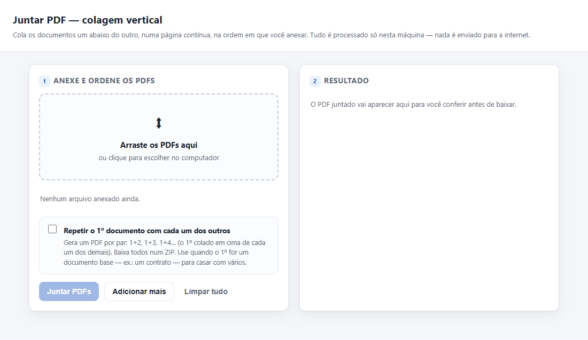

# Juntar PDF — colagem vertical

Junta dois ou mais PDFs **um abaixo do outro**, numa página contínua, **sem perder qualidade** e **100% na sua máquina** — nada é enviado para a internet.

Não é a mesma coisa que empilhar páginas soltas: a ferramenta faz uma **composição vertical**, como se os documentos fossem colados numa única folha comprida. Útil, por exemplo, para unir um contrato e uma planilha num documento só.




## Por que é fiel aos originais

- **Vetorial, sem rasterizar.** Cada página entra como objeto vetorial no PDF final: texto continua texto pesquisável e imagem fica na resolução original. Não vira "foto" — número pequeno e assinatura não borram.
- **Respeita o tamanho de cada documento.** Páginas de larguras diferentes ficam **centralizadas**, com **espaço em branco nas laterais** — nunca corta nem estica.
- **Endireita páginas giradas** (digitalizações) antes de colar.
- **Respeita o limite do formato PDF** (≈ 200 polegadas de altura): se a pilha passar disso, continua na próxima página alta, sem cortar nada.
- **Ordem de inserção preservada** — o resultado segue exatamente a ordem em que os arquivos foram adicionados.

## Dois modos

- **Normal:** cola todos os PDFs num documento só.
- **Repetir o 1º com cada um dos outros:** o primeiro documento vira a base e é colado com cada um dos demais (`1+2`, `1+3`, `1+4`…), gerando um PDF por par — ótimo para casar um documento-base com vários.

## Como usar

**Aplicativo de janela (recomendado)**

```bash
python app_desktop.py
```

Abre uma janela: arraste os PDFs, ordene, clique em **Juntar** e escolha onde salvar. (No Windows, empacotável num `.exe` único com [PyInstaller](https://pyinstaller.org/), sem exigir Python na máquina de destino.)

**Versão web local** (processa tudo em `127.0.0.1`, nada sai do computador)

```bash
python app.py
```

**Como biblioteca**

```python
from juntar_pdf import juntar_vertical

with open("contrato.pdf", "rb") as a, open("planilha.pdf", "rb") as b:
    pdf = juntar_vertical([("contrato.pdf", a.read()), ("planilha.pdf", b.read())])
open("juntado.pdf", "wb").write(pdf)
```

## Como funciona

O motor ([`juntar_pdf.py`](juntar_pdf.py)) empilha as páginas numa página única "alta":

1. Lê todas as páginas na ordem e **endireita** as que têm rotação (`transfer_rotation_to_content`).
2. Agrupa o que couber na altura máxima do formato PDF (14400 pt); se passar, abre outra página alta.
3. Para cada grupo, cria uma página em branco com a **maior largura** e a **soma das alturas**, e posiciona cada página de origem no seu tamanho real, **centralizada**, via `merge_transformed_page` (composição vetorial).

Testado com páginas de tamanhos diferentes, documentos de várias páginas e páginas giradas, conferindo que nada é cortado, esticado nem perdido.

## Tecnologias

`Python` · `pypdf` (composição vetorial) · `PyMuPDF` (pré-visualização) · `Flask` (versão web) · `Tkinter` (app de janela) · `PyInstaller` (executável)

## Autor

**Felipe Nunes** — Desenvolvedor · Automação & Python
[LinkedIn](https://www.linkedin.com/in/felipe-giuliano)

## Licença

[MIT](LICENSE)
